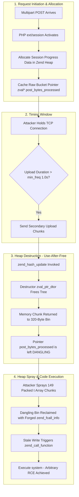
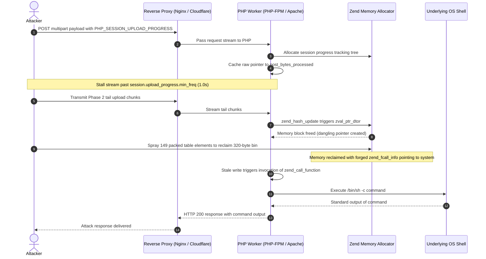
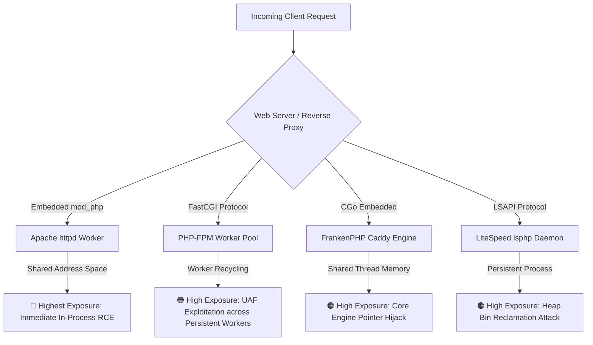
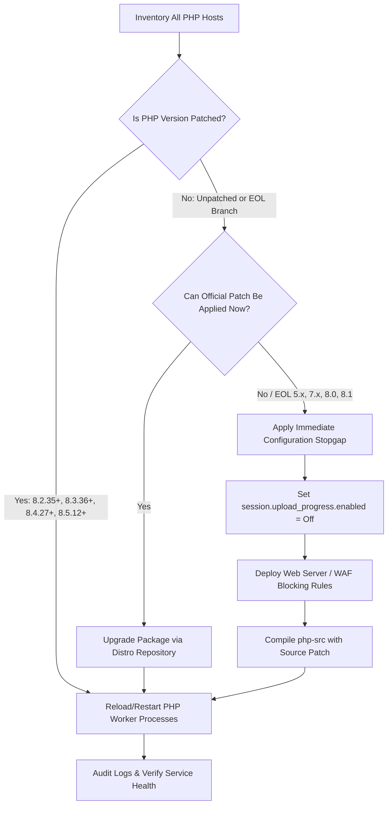

# ⚡ php2shell: Pre-Auth Remote Code Execution in PHP Core
### *In-Depth Technical Analysis, Proof-of-Concept Exploit, and Comprehensive Defense Matrix for CVE-2026-109618 & CVE-2026-109619*

<p align="center">
  <a href="https://github.com/faizan-khanx/php2shell/stargazers"></a>
  <a href="https://github.com/faizan-khanx/php2shell/network/members"></a>
  <a href="https://github.com/faizan-khanx/php2shell/issues"></a>
  <a href="LICENSE"></a>
  <a href="https://www.linkedin.com/in/ethicalfaizan"></a>
  <a href="https://github.com/faizan-khanx"></a>
</p>

<p align="center">
  
  
  
  
  
  
</p>

---

## 📰 Featured Editorial Coverage

<table>
  <tr>
    <td width="30%" align="center">
      <a href="https://hackernews.in/article/php2shell-explained-the-unauthenticated-rce-hiding">
        
      </a>
      <br>
      <a href="https://hackernews.in/article/php2shell-explained-the-unauthenticated-rce-hiding"><strong>🔗 Read Full Article on HackerNews.in</strong></a>
    </td>
    <td>
      <h3><a href="https://hackernews.in/article/php2shell-explained-the-unauthenticated-rce-hiding">PHP2Shell Explained: CVE-2026-109618 & CVE-2026-109619, the Unauthenticated RCE in PHP Itself</a></h3>
      <p>
        An exhaustive technical breakdown examining why <strong>PHP2Shell</strong> is fundamentally different from everyday web application bugs. Explores how unexpected request termination corrupts internal interpreter state, how 20-year-old session tracking primitives were synthesized into weaponized exploits via modern AI tooling, and why standard perimeter WAFs struggle to fully neutralize it.
      </p>
      <ul>
        <li><strong>Original Publication:</strong> <a href="https://hackernews.in/article/php2shell-explained-the-unauthenticated-rce-hiding"><code>hackernews.in/article/php2shell-explained...</code></a></li>
        <li><strong>Focus Areas:</strong> Out-of-Memory (OOM) Teardown, RFC 1867 Heap Use-After-Free, Arbitrary Memory Disclosure, and Defense-in-Depth verification.</li>
      </ul>
      <p>
        <a href="https://hackernews.in/article/php2shell-explained-the-unauthenticated-rce-hiding">
          
        </a>
      </p>
    </td>
  </tr>
</table>

---

> [!CAUTION]
> **CRITICAL SECURITY ADVISORY (CVSS v4.0: 9.2 - Critical):**  
> **php2shell** affects the core runtime engine of PHP (`ext/session/session.c`). Unauthenticated remote attackers can execute arbitrary operating system commands directly on web servers by triggering a heap Use-After-Free (UAF) condition during RFC 1867 multipart session upload progress tracking. All organizations running web-facing PHP installations must patch their runtime or apply immediate configuration stopgaps.

---

<p align="center">
  
  <br>
  <em>Fig 1: PHP2Shell memory corruption, heap reclamation, and execution flow</em>
</p>

---

## 📑 Table of Contents

- [1. Executive Summary](#1-executive-summary)
- [2. Architectural Anatomy: Why PHP2Shell is Different](#2-architectural-anatomy-why-php2shell-is-different)
- [3. Deep-Dive Vulnerability Analysis](#3-deep-dive-vulnerability-analysis)
  - [3.1 CVE-2026-109618: Out-of-Memory (OOM) Teardown Hijack](#31-cve-2026-109618-out-of-memory-oom-teardown-hijack)
  - [3.2 CVE-2026-109619: Stale Global State & RFC 1867 Heap UAF](#32-cve-2026-109619-stale-global-state--rfc-1867-heap-uaf)
  - [3.3 Memory Lifecycle & Corruption Workflow (Mermaid Diagram)](#33-memory-lifecycle--corruption-workflow)
  - [3.4 Protocol Exploit Sequence (Mermaid Sequence Diagram)](#34-protocol-exploit-sequence)
  - [3.5 Text / ASCII Architecture Flowchart](#35-text--ascii-architecture-flowchart)
- [4. Deployment Risk & SAPI Comparison](#4-deployment-risk--sapi-comparison)
  - [Deployment Attack Surface Map (Mermaid Diagram)](#deployment-attack-surface-map)
- [5. Arbitrary Memory Disclosure Risk](#5-arbitrary-memory-disclosure-risk)
- [6. Affected vs. Patched PHP Versions](#6-affected-vs-patched-php-versions)
- [7. Repository Architecture](#7-repository-architecture)
- [8. Proof of Concept (PoC) & Exploit Guide](#8-proof-of-concept-poc--exploit-guide)
  - [Quickstart & Verification](#quickstart--verification)
  - [CLI Flags & Parameter Reference](#cli-flags--parameter-reference)
  - [Dry-Run Payload Analysis](#dry-run-payload-analysis)
- [9. Defense & Remediation Matrix](#9-defense--remediation-matrix)
  - [Remediation Decision Tree (Mermaid Diagram)](#remediation-decision-tree)
  - [Tier 1: Configuration Stopgap (Immediate)](#tier-1-configuration-stopgap-immediate)
  - [Tier 2: Automated Host Mitigation Utility (`quick-fix/mitigate.sh`)](#tier-2-automated-host-mitigation-utility)
  - [Tier 3: Web Server & WAF Filtering Rules](#tier-3-web-server--waf-filtering-rules)
  - [Tier 4: C-Source Code Patch (`php-src`)](#tier-4-c-source-code-patch-php-src)
- [10. Threat Hunting, Detection & Indicators of Compromise (IoCs)](#10-threat-hunting-detection--indicators-of-compromise-iocs)
- [11. Star History](#11-star-history)
- [12. Author & Community Connect](#12-author--community-connect)
- [13. Disclaimer & License](#13-disclaimer--license)

---

## 1. Executive Summary

On October 20, 2026, details of two pre-authentication Remote Code Execution (RCE) flaws affecting the PHP core leaked publicly prior to coordinated vendor disclosure. Assigned identifiers **CVE-2026-109618** and **CVE-2026-109619**, these vulnerabilities allow remote, unauthenticated attackers to execute arbitrary system commands under the security context of the web worker process (`www-data`, `nobody`, `apache`).

* **Core Engine Flaw:** Unlike 99% of web vulnerabilities that target application logic (plugins, framework routing, SQL queries, or file upload handlers), PHP2Shell strikes the underlying interpreter that executes the code.
* **Universal Exposure:** Pristine, bug-free web applications (including default WordPress, Laravel, or custom static scripts) are exposed if running on unpatched PHP runtimes.
* **Default Active Surface:** PHP's RFC 1867 upload progress tracking mechanism (`session.upload_progress.enabled = 1`) is enabled by default in virtually all official and distribution-packaged builds.

---

## 2. Architectural Anatomy: Why PHP2Shell is Different

To understand the severity of PHP2Shell, one must recognize the architectural boundary between application code and runtime interpreter:

```
+--------------------------------------------------------------+
|                     Web Application Layer                    |
|   (WordPress, Laravel, Drupal, Magento, Custom PHP Apps)     |
|   - Inputs sanitized, parameterized queries, strict typing    |
|   - ZERO application-layer vulnerabilities present           |
+--------------------------------------------------------------+
                               │
               Executes on top of the runtime
                               ▼
+==============================================================+
|                 PHP Runtime Engine (php-src)                 |  <--- [VULNERABLE LAYER]
|  - RFC 1867 Multipart Parser (ext/session/session.c)         |
|  - Zend Memory Manager (Zend MM Heap Allocator)              |  <--- Heap Use-After-Free
|  - Fatal Error Backtrace & OPcache Subsystems                |  <--- Uninitialized Pointers
+==============================================================+
                               │
               Interacts with OS & Web Server
                               ▼
+--------------------------------------------------------------+
|             Web Server & Operating System Layer              |
|        (Nginx, Apache, PHP-FPM, Linux Kernel, System)        |
+--------------------------------------------------------------+
```

1. **Application hardening does not mitigate this:** Sanity checks, input filters, and prepared statements execute *after* or *parallel to* request bootstrapping. The vulnerability is triggered during early raw multipart parsing before application logic executes.
2. **WAF evasion is trivial without strict header blocks:** Because web application firewalls parse multipart form data differently than PHP's internal lexer, attackers can format boundaries and header parameters (e.g., `multipart/form-data,boundary=x`) to bypass perimeter inspections.
3. **Updating framework code will not fix it:** Updating plugins or CMS core versions leaves the vulnerable PHP binary untouched. The operating system package, container base image, or source binary must be updated directly.

---

## 3. Deep-Dive Vulnerability Analysis

Both vulnerabilities are rooted in **CWE-824 (Access of Uninitialized Pointer)** and improper resource management when a request terminates unexpectedly.

### 3.1 CVE-2026-109618: Out-of-Memory (OOM) Teardown Hijack

CVE-2026-109618 focuses on premature request termination induced by memory exhaustion:
- An attacker sends an engineered multipart request designed to exceed PHP's `memory_limit` during early hash table or session array allocation.
- When an OOM condition is triggered during specific initialization phases, PHP invokes internal bailout routines to free request memory.
- However, destructor handlers (`zval_ptr_dtor`) and global pointer caches become decoupled: internal structures retain references to memory addresses that the Zend Memory Manager has already recycled into free bins.
- By structuring subsequent heap operations, the attacker induces Zend's function execution engine (`zend_call_function`) to treat a controlled memory block as an executable call frame.

### 3.2 CVE-2026-109619: Stale Global State & RFC 1867 Heap UAF

CVE-2026-109619 exploits PHP's session upload progress tracking callback (`php_session_rfc1867_callback` in `ext/session/session.c`):
- When progress tracking starts, PHP caches raw `zval *` bucket pointers inside its internal progress structure:
  - `progress->post_bytes_processed` (points to `data["bytes_processed"]`)
  - `progress->current_file_bytes_processed` (points to `file["bytes_processed"]`)
- **Frequency Update Stall:** The attacker stalls data transmission past `session.upload_progress.min_freq` (default: 1.0 second).
- **Destruction:** The next incoming data chunk initiates an update cycle. `zend_hash_update()` destroys the previous data tree, triggering `zval_ptr_dtor()`. The memory backing the progress counters is returned to the heap, but `progress->post_bytes_processed` is never refreshed, becoming a **dangling pointer**.
- **Heap Reclamation:** The attacker immediately transmits 149 packed array elements (`t[]`) sized to fit the 320-byte bin, reclaiming the freed memory and placing forged `zend_fcall_info` and `zend_internal_function` structures at known offsets.
- **Arbitrary Execution:** Stale pointer writes trigger `zend_call_function()`, resulting in direct command invocation (e.g., `system()`).

---

### 3.3 Memory Lifecycle & Corruption Workflow



---

### 3.4 Protocol Exploit Sequence



---

### 3.5 Text / ASCII Architecture Flowchart

<details>
<summary><strong>Text / ASCII Architecture Flowchart (Click to expand)</strong></summary>

```
[ Attacker Request ]
        │
        ├──> Phase 1: Multipart POST with PHP_SESSION_UPLOAD_PROGRESS
        │             PHP caches raw zval* bucket pointer to data["bytes_processed"]
        │
        ├──> Stall: Sleep for stall duration (> min_freq 1.0s)
        │
        ├──> Phase 2: Tail chunks arrive -> zend_hash_update() calls zval_ptr_dtor()
        │             --> Memory is FREED (dangling pointer created in Zend Heap)
        │
        ├──> Reclaim: Sprays 149 packed t[] entries to reclaim 320-byte bin
        │             --> Forges zend_fcall_info & zend_internal_function
        │
        └──> Execution: Stale pointer write triggers zend_call_function()
                      --> system("/bin/sh -c <command>")
```
</details>

---

## 4. Deployment Risk & SAPI Comparison

The practical risk of exploitation varies significantly based on how PHP is interfaced with the web server:

| Server API (SAPI) | Architecture Overview | Relative Risk | Operational Impact |
| :--- | :--- | :--- | :--- |
| **Apache `mod_php`** | PHP executes inside the Apache worker process. | 🔴 **Critical / Highest** | Single-request exploitation achievable before application routing starts. Process memory space shared with Apache core. |
| **PHP-FPM** | Isolated worker pool managed by FPM master. | 🟠 **High** | Worker terminates upon fatal error, altering exploit timing. Both CVEs are demonstrated under standard FPM pool setups. |
| **FrankenPHP** | Caddy-backed modern Go runtime with embedded CGo PHP. | 🟠 **High** | Exposed to upload progress UAF when standard RFC 1867 tracking is left enabled. |
| **LiteSpeed (`lsphp`)** | LiteSpeed Server Application Protocol. | 🟠 **High** | Reusable `lsphp` processes are susceptible to sequential state pollution and memory reclamation attacks. |

### Deployment Attack Surface Map



---

## 5. Arbitrary Memory Disclosure Risk

Even when an exploit attempt fails to achieve remote code execution (e.g., due to ASLR variance or non-standard memory layout), the underlying Use-After-Free condition allows attackers to **read arbitrary memory from the PHP worker process**.

Because PHP worker processes are recycled across different user sessions, uninitialized heap regions frequently contain residual data from prior transactions:
- **Database Credentials:** MySQL/PostgreSQL usernames, passwords, and connection strings.
- **Session Tokens:** Active admin sessions, user cookies, and authentication headers.
- **Application Secrets:** Secret keys, `.env` file contents, and API credentials (AWS, Stripe, SendGrid).
- **Cryptographic Keys:** Private TLS certificates, signing keys, and HMAC salts.

> [!WARNING]
> Security teams must assume that any unpatched host subjected to exploitation attempts may have had secrets exposed. Credential rotation is strongly advised post-remediation.

---

## 6. Affected vs. Patched PHP Versions

| PHP Branch  | Support Status       | Vulnerable Versions | Patched / Secure Release | Mitigation Status |
| :---------- | :------------------- | :------------------ | :----------------------- | :---------------- |
| **PHP 8.5** | Supported (Active)   | `< 8.5.12`          | **8.5.12**               | Official emergency security release published |
| **PHP 8.4** | Supported (Active)   | `< 8.4.27`          | **8.4.27**               | Official emergency security release published |
| **PHP 8.3** | Supported (Active)   | `< 8.3.36`          | **8.3.36**               | Official emergency security release published |
| **PHP 8.2** | Supported (Security) | `< 8.2.35`          | **8.2.35**               | Official emergency security release published |
| **PHP 8.1** | End of Life (EOL)    | All versions        | No Official Patch        | ⚠️ Configuration stopgap or source patch mandatory |
| **PHP 8.0** | End of Life (EOL)    | All versions        | No Official Patch        | ⚠️ Configuration stopgap or source patch mandatory |
| **PHP 7.x** | End of Life (EOL)    | All 7.0 - 7.4       | No Official Patch        | ⚠️ Configuration stopgap or source patch mandatory |
| **PHP 5.x** | End of Life (EOL)    | 5.4.0+              | No Official Patch        | ⚠️ Isolate host / Disable upload progress |

---

## 7. Repository Architecture

```
php2shell/
├── README.md                                  # Comprehensive security guide & advisory
├── LICENSE                                    # MIT License
├── .gitignore                                 # Git ignore patterns
│
├── poc/                                       # Proof of Concept
│   ├── exploit.py                             # Python 3 Exploit (HTTP & HTTPS)
│   ├── poc_109618.py                          # Compatibility alias
│   ├── README.md                              # PoC technical details & layout offsets
│   └── requirements.txt                       # Environment requirements (stdlib only)
│
├── mitigations/                               # Web Server & WAF Hardening Rules
│   ├── nginx/
│   │   └── php2shell.conf                     # FastCGI multipart block snippet
│   ├── apache/
│   │   ├── .htaccess                          # mod_rewrite multipart block
│   │   └── modsecurity-php2shell.conf         # ModSecurity inspection rule
│   ├── cloudflare/
│   │   └── README.md                          # Cloudflare WAF custom expression
│   ├── frankenphp/
│   │   └── Caddyfile                          # Caddyfile directive snippet
│   └── lighttpd/
│       └── php2shell.conf                     # Lighttpd url.access-deny snippet
│
├── patch/                                     # C Source Code Patch
│   └── session-upload-progress-counters.patch # Patch resolving pointer caching in php-src
│
└── quick-fix/                                 # Host Automation Script
    ├── mitigate.sh                            # Primary Bash utility (check, audit, fix)
    └── run.sh                                 # Compatibility wrapper
```

---

## 8. Proof of Concept (PoC) & Exploit Guide

The PoC exploit is provided in [`poc/exploit.py`](poc/exploit.py) (with alias [`poc/poc_109618.py`](poc/poc_109618.py)). It reproduces the heap Use-After-Free condition across standard HTTP and HTTPS connections with self-signed certificate support.

### Quickstart & Verification

```bash
# Clone the repository
git clone https://github.com/faizan-khanx/php2shell.git
cd php2shell

# 1. Run dry-run verification (generates payload locally without network transmission)
python3 poc/exploit.py http://127.0.0.1:8080/index.php --dry

# 2. Execute verification exploit against controlled laboratory target
python3 poc/exploit.py http://127.0.0.1:8080/index.php --command "id; whoami; uname -a"
```

### CLI Flags & Parameter Reference

| Flag | Default | Description |
| :--- | :--- | :--- |
| `url` | `http://127.0.0.1:80/index.php` | Target URL running any reachable PHP script |
| `--command` | `uname -a; id; echo JACKALPOC` | System command to execute on target |
| `--sid` | Auto-generated | Session identifier passed via `PHPSESSID` |
| `--stall` | `1.35` | Delay in seconds between Phase 1 and reclamation spray |
| `--dtor` | `0` | Leaked `zval_ptr_dtor` address for layout offsets |
| `--call` | `""` | Direct override for `zend_call_function` address |
| `--dry` | `False` | Write forged body to `body-109618.bin` without sending |

### Dry-Run Payload Analysis

Running with `--dry` dumps the exact multipart byte sequence to `body-109618.bin`:
```bash
python3 poc/exploit.py http://127.0.0.1:8080/index.php --dry
# Output: 109618 phase1=5439 total=62929 n=149 blob=288 call=0x0
```
This allows defenders to inspect boundary formats, offsets, and header structure in Wireshark or hex editors without executing network traffic.

---

## 9. Defense & Remediation Matrix

### Remediation Decision Tree



---

### Tier 1: Configuration Stopgap (Immediate)

Disabling PHP session upload progress completely neutralizes the exploit vector while preserving normal file upload functionality.

**In `php.ini`:**
```ini
session.upload_progress.enabled = Off
```

**In PHP-FPM Pool Configuration (`/etc/php/*/fpm/pool.d/www.conf`):**
```ini
php_admin_flag[session.upload_progress.enabled] = off
```

**Restart Web & PHP Services:**
```bash
sudo systemctl reload php*-fpm || sudo systemctl restart apache2
```

---

### Tier 2: Automated Host Mitigation Utility

A mitigation and auditing Bash utility is available in [`quick-fix/mitigate.sh`](quick-fix/mitigate.sh) (alias: [`quick-fix/run.sh`](quick-fix/run.sh)):

```bash
# 1. Audit all PHP binaries on the system (Read-Only)
sudo ./quick-fix/mitigate.sh --check

# 2. Preview changes without modifying files (Dry Run)
sudo ./quick-fix/mitigate.sh --dry-run

# 3. Apply mitigation across all installed PHP environments
sudo ./quick-fix/mitigate.sh

# 4. Search for Indicators of Compromise (last 48 hours)
sudo ./quick-fix/mitigate.sh --audit=48

# 5. Revert backups if required
sudo ./quick-fix/mitigate.sh --revert
```

---

### Tier 3: Web Server & WAF Filtering Rules

Configuration templates are organized under [`mitigations/`](mitigations/):

* **Nginx ([`mitigations/nginx/`](mitigations/nginx/)):** Drops multipart POST/PUT/PATCH requests before forwarding to PHP-FPM on non-upload routes.
* **Apache ([`mitigations/apache/`](mitigations/apache/)):** `.htaccess` mod_rewrite rules and a ModSecurity rule blocking `PHP_SESSION_UPLOAD_PROGRESS`.
* **Cloudflare WAF ([`mitigations/cloudflare/`](mitigations/cloudflare/)):** Firewall expression blocking multipart on non-upload URIs and enterprise body inspections.
* **FrankenPHP ([`mitigations/frankenphp/`](mitigations/frankenphp/)):** Caddyfile directive setting `php_ini session.upload_progress.enabled 0`.
* **Lighttpd ([`mitigations/lighttpd/`](mitigations/lighttpd/)):** Header filter denying multipart requests.

---

### Tier 4: C-Source Code Patch (`php-src`)

For custom builds or backporting to EOL distributions, apply [`patch/session-upload-progress-counters.patch`](patch/session-upload-progress-counters.patch):

```bash
cd /path/to/php-src
git apply --check /path/to/patch/session-upload-progress-counters.patch
git apply /path/to/patch/session-upload-progress-counters.patch
make -j"$(nproc)" && sudo make install
sudo systemctl restart php-fpm
```

---

## 10. Threat Hunting, Detection & Indicators of Compromise (IoCs)

Exploitation manifests as abnormal child processes spawned directly by PHP runtime workers (`php-fpm`, `php-cgi`, `apache2`, `httpd`, `lsphp`).

### High-Priority Behavioral Indicators:
- **Interactive Shells:** `/bin/sh`, `/bin/bash`, `cmd.exe`, `powershell.exe` spawned by web server users.
- **System Reconnaissance:** Invocations of `whoami`, `id`, `uname -a`, `ipconfig`, `netstat`.
- **Network Transfer Tools:** Outbound connections via `curl`, `wget`, `nc`, `certutil.exe`.
- **Reverse Shell Invocations:** Direct execution of `/dev/tcp/`, `mkfifo`, or `fsockopen`.

### Log Hunting Queries:
```bash
# 1. Search for memory limit errors and fatal exceptions in PHP logs
grep -R "Allowed memory size" /var/log/php* /var/log/nginx/ /var/log/apache2/ 2>/dev/null | tail -50
grep -R "Fatal error" /var/log/ 2>/dev/null | tail -50

# 2. Check for sudden spikes in HTTP 500 error rates
awk '$9==500 {print substr($4,2,17)}' /var/log/nginx/access.log 2>/dev/null | sort | uniq -c | sort -nr | head -20

# 3. Identify recently created or modified PHP files in web roots
find /var/www -type f -name "*.php" -mtime -3 -ls 2>/dev/null
```

Detection tools like [Florian Roth's process-watcher](https://github.com/Neo23x0/process-watcher) can be run to alert on unexpected child process spawning in real time.

---

## 11. Star History

<p align="center">
  <a href="https://star-history.com/#faizan-khanx/php2shell&Date">
    
  </a>
</p>

---

## 12. Author & Community Connect

<table>
  <tr>
    <td align="center" width="20%">
      <a href="https://github.com/faizan-khanx">
        
      </a>
      <br>
      <strong>Faizan Khan</strong>
    </td>
    <td>
      <p>
        Security Researcher, Ethical Hacker & Author focusing on offensive security, threat intelligence, and vulnerability research.
      </p>
      <p>
        <a href="https://www.linkedin.com/in/ethicalfaizan">
          
        </a>
        &nbsp;
        <a href="https://github.com/faizan-khanx">
          
        </a>
        &nbsp;
        <a href="https://hackernews.in/article/php2shell-explained-the-unauthenticated-rce-hiding">
          
        </a>
      </p>
      <p>
        📬 <em>Feel free to connect for collaborations, responsible vulnerability disclosure, or security research queries!</em>
      </p>
    </td>
  </tr>
</table>

---

## 13. Disclaimer & License

This project is created strictly for educational purposes, authorized security auditing, and defensive vulnerability research. Testing systems without prior mutual consent is unlawful. The author assumes no liability for damages or misuse.

Distributed under the [MIT License](LICENSE).
