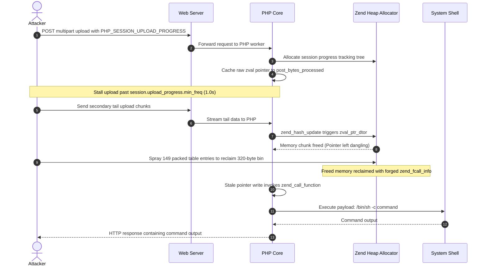

# ⚡ php2shell: Pre-Auth Remote Code Execution in PHP Core
### *Analysis, Proof-of-Concept Exploit, and Defense Matrix for CVE-2026-109618 & CVE-2026-109619*

<p align="center">
  <a href="https://github.com/faizan-khanx/php2shell/stargazers"></a>
  <a href="https://github.com/faizan-khanx/php2shell/network/members"></a>
  <a href="https://github.com/faizan-khanx/php2shell/issues"></a>
  <a href="LICENSE"></a>
  <a href="https://www.linkedin.com/in/ethicalfaizan"></a>
  <a href="https://github.com/faizan-khanx"></a>
</p>

<p align="center">
  
  
  
  
  
</p>

---

## 📰 Featured Publication: Full Technical Deep-Dive

<table>
  <tr>
    <td width="32%" align="center">
      <a href="https://hackernews.in/article/php2shell-explained-the-unauthenticated-rce-hiding">
        
      </a>
      <br>
      <a href="https://hackernews.in/article/php2shell-explained-the-unauthenticated-rce-hiding"><strong>🔗 Read Full Story on HackerNews</strong></a>
    </td>
    <td>
      <h3><a href="https://hackernews.in/article/php2shell-explained-the-unauthenticated-rce-hiding">PHP2Shell Explained: CVE-2026-109618 & CVE-2026-109619, the Unauthenticated RCE in PHP Itself</a></h3>
      <p>
        An exhaustive, peer-reviewed technical breakdown examining why <strong>PHP2Shell</strong> is fundamentally different from typical application-layer bugs. Discover the internal mechanics behind PHP's abnormal request teardown, how 20-year-old memory safety primitives were weaponized via modern AI-assisted research, and why standard WAFs struggle to fully defend against it.
      </p>
      <ul>
        <li><strong>Live Publication:</strong> <a href="https://hackernews.in/article/php2shell-explained-the-unauthenticated-rce-hiding"><code>hackernews.in/article/php2shell-explained...</code></a></li>
        <li><strong>Offline Local Copy:</strong> Included in this repository at <a href="article.md"><code>article.md</code></a></li>
        <li><strong>Core Insights:</strong> Memory Exhaustion (OOM) Chains, Heap Use-After-Free in RFC 1867, and Defense-in-Depth verification.</li>
      </ul>
      <p>
        <a href="https://hackernews.in/article/php2shell-explained-the-unauthenticated-rce-hiding">
          
        </a>
      </p>
    </td>
  </tr>
</table>

---

> [!CAUTION]
> **CRITICAL SECURITY ADVISORY (CVSS v4.0: 9.2 - Critical):**  
> **php2shell** affects the core runtime engine of PHP (`ext/session/session.c`). Unauthenticated remote attackers can execute arbitrary operating system commands directly on web servers by triggering a heap Use-After-Free (UAF) condition during RFC 1867 multipart session upload progress tracking.

---

## 📑 Table of Contents

- [1. Executive Summary](#1-executive-summary)
- [2. Vulnerability Deep-Dive & Root Cause](#2-vulnerability-deep-dive--root-cause)
  - [Memory Corruption Workflow](#memory-corruption-workflow)
  - [Exploit Flow Architecture (Mermaid & ASCII)](#exploit-flow-architecture)
- [3. Affected vs. Patched PHP Versions](#3-affected-vs-patched-php-versions)
- [4. Repository Architecture](#4-repository-architecture)
- [5. Proof of Concept (PoC)](#5-proof-of-concept-poc)
  - [Quickstart & Setup](#quickstart--setup)
  - [CLI Flags & Options](#cli-flags--options)
- [6. Defense & Remediation Matrix](#6-defense--remediation-matrix)
  - [Tier 1: Configuration Stopgap (Immediate)](#tier-1-configuration-stopgap-immediate)
  - [Tier 2: Automated Host Mitigation Script](#tier-2-automated-host-mitigation-script)
  - [Tier 3: Web Server & WAF Protection (Nginx, Apache, Cloudflare, FrankenPHP, Lighttpd)](#tier-3-web-server--waf-protection)
  - [Tier 4: C-Source Code Patch (`php-src`)](#tier-4-c-source-code-patch-php-src)
- [7. Threat Hunting & Incident Response (IoCs)](#7-threat-hunting--incident-response-iocs)
- [8. Star History](#8-star-history)
- [9. Author & Connect](#9-author--connect)
- [10. Disclaimer & License](#10-disclaimer--license)

---

## 1. Executive Summary

Most web vulnerabilities reside in application code (plugins, CMS logic, or custom endpoints). **PHP2Shell resides in the PHP core engine itself.**

* **Even hardened applications are vulnerable** when executing on unpatched PHP runtimes.
* **Updating frameworks (WordPress, Laravel, Drupal) does NOT fix this issue.** The PHP runtime package or container image itself must be updated.
* **Default Exposure:** PHP's session upload progress mechanism (`session.upload_progress.enabled = 1`) is enabled by default in standard PHP installations.

---

## 2. Vulnerability Deep-Dive & Root Cause

The vulnerability originates in `php_session_rfc1867_callback` inside `ext/session/session.c`. When tracking file upload progress via RFC 1867, PHP retains raw `zval *` bucket pointers inside its internal progress struct:

- `progress->post_bytes_processed` (points to `data["bytes_processed"]`)
- `progress->current_file_bytes_processed` (points to `file["bytes_processed"]`)

### Memory Corruption Workflow

1. **Initiation:** The attacker sends a multipart `POST` upload containing `PHP_SESSION_UPLOAD_PROGRESS`. PHP initializes upload progress tracking and caches the raw bucket pointer.
2. **Stall Cycle:** The attacker halts data transmission for a duration exceeding `session.upload_progress.min_freq` (default: 1.0 second).
3. **Heap Free (Use-After-Free):** The next data chunk triggers a progress update. `zend_hash_update()` destroys the previous data tree using `zval_ptr_dtor()`. This frees the memory chunk, leaving the progress pointers **dangling**.
4. **Reclamation Spray:** The attacker sprays 149 packed table entries (`t[]`) to reclaim the 320-byte heap bin, forging `zend_fcall_info` and `zend_internal_function` structures.
5. **Execution:** Stale pointer write triggers `zend_call_function()`, invoking `system()` with arbitrary attacker-supplied commands.

### Exploit Flow Architecture



<details>
<summary><strong>Text / ASCII Architecture Flowchart (Click to expand)</strong></summary>

```
[ Attacker Request ]
        │
        ├──> Phase 1: Multipart POST with PHP_SESSION_UPLOAD_PROGRESS
        │             PHP caches raw zval* bucket pointer to data["bytes_processed"]
        │
        ├──> Stall: Sleep for stall duration (> min_freq 1.0s)
        │
        ├──> Phase 2: Tail chunks arrive -> zend_hash_update() calls zval_ptr_dtor()
        │             --> Memory is FREED (dangling pointer created in Zend Heap)
        │
        ├──> Reclaim: Sprays 149 packed t[] entries to reclaim 320-byte bin
        │             --> Forges zend_fcall_info & zend_internal_function
        │
        └──> Execution: Stale pointer write triggers zend_call_function()
                      --> system("/bin/sh -c <command>")
```
</details>

---

## 3. Affected vs. Patched PHP Versions

| PHP Branch  | Status               | Vulnerable Versions | Patched / Secure Release | Mitigation Status |
| :---------- | :------------------- | :------------------ | :----------------------- | :---------------- |
| **PHP 8.5** | Supported (Active)   | `< 8.5.12`          | **8.5.12**               | Official emergency release available |
| **PHP 8.4** | Supported (Active)   | `< 8.4.27`          | **8.4.27**               | Official emergency release available |
| **PHP 8.3** | Supported (Active)   | `< 8.3.36`          | **8.3.36**               | Official emergency release available |
| **PHP 8.2** | Supported (Security) | `< 8.2.35`          | **8.2.35**               | Official emergency release available |
| **PHP 8.1** | End of Life (EOL)    | All versions        | No Official Vendor Patch | ⚠️ Config mitigation / Source patch mandatory |
| **PHP 8.0** | End of Life (EOL)    | All versions        | No Official Vendor Patch | ⚠️ Config mitigation / Source patch mandatory |
| **PHP 7.x** | End of Life (EOL)    | All 7.0 - 7.4       | No Official Vendor Patch | ⚠️ Config mitigation / Source patch mandatory |
| **PHP 5.x** | End of Life (EOL)    | 5.4.0+              | No Official Vendor Patch | ⚠️ Isolate host / Disable upload progress |

---

## 4. Repository Architecture

```
php2shell/
├── README.md                                  # Comprehensive security guide & advisory
├── article.md                                 # Full technical article & background write-up
├── LICENSE                                    # MIT License
├── .gitignore                                 # Git ignore patterns
│
├── poc/                                       # Proof of Concept
│   ├── exploit.py                             # Python 3 Exploit (HTTP & HTTPS)
│   ├── poc_109618.py                          # Compatibility alias
│   ├── README.md                              # PoC technical details & layout offsets
│   └── requirements.txt                       # Environment requirements (stdlib only)
│
├── mitigations/                               # Web Server & WAF Hardening Rules
│   ├── nginx/
│   │   └── php2shell.conf                     # FastCGI multipart block snippet
│   ├── apache/
│   │   ├── .htaccess                          # mod_rewrite multipart block
│   │   └── modsecurity-php2shell.conf         # ModSecurity inspection rule
│   ├── cloudflare/
│   │   └── README.md                          # Cloudflare WAF custom expression
│   ├── frankenphp/
│   │   └── Caddyfile                          # Caddyfile directive snippet
│   └── lighttpd/
│       └── php2shell.conf                     # Lighttpd url.access-deny snippet
│
├── patch/                                     # C Source Code Patch
│   └── session-upload-progress-counters.patch # Patch resolving pointer caching in php-src
│
└── quick-fix/                                 # Host Automation Script
    ├── mitigate.sh                            # Primary Bash utility (check, audit, fix)
    └── run.sh                                 # Compatibility wrapper
```

---

## 5. Proof of Concept (PoC)

The PoC exploit is provided in [`poc/exploit.py`](poc/exploit.py) (with alias [`poc/poc_109618.py`](poc/poc_109618.py)). It verifies whether a PHP endpoint is vulnerable to **CVE-2026-109618**.

### Quickstart & Setup

```bash
# Clone the repository
git clone https://github.com/faizan-khanx/php2shell.git
cd php2shell

# Run dry-run (generates forged payload locally without network transmission)
python3 poc/exploit.py http://127.0.0.1:8080/index.php --dry

# Execute against target laboratory host
python3 poc/exploit.py http://127.0.0.1:8080/index.php --command "id; whoami; uname -a"
```

### CLI Flags & Options

| Flag | Default | Description |
| :--- | :--- | :--- |
| `url` | `http://127.0.0.1:80/index.php` | Target URL running any reachable PHP script |
| `--command` | `uname -a; id; echo JACKALPOC` | System command to execute on target |
| `--sid` | Auto-generated | Session ID passed via `PHPSESSID` |
| `--stall` | `1.35` | Delay in seconds between Phase 1 and reclamation spray |
| `--dtor` | `0` | Leaked `zval_ptr_dtor` address for layout offsets |
| `--call` | `""` | Direct override for `zend_call_function` address |
| `--dry` | `False` | Write forged body to `body-109618.bin` without sending |

> For deeper memory profiling and target offset calculations, consult [`poc/README.md`](poc/README.md).

---

## 6. Defense & Remediation Matrix

### Tier 1: Configuration Stopgap (Immediate)

Disabling PHP session upload progress completely neutralizes the attack vector while preserving regular file uploads:

**In `php.ini`:**
```ini
session.upload_progress.enabled = Off
```

**In PHP-FPM Pool Configuration (`/etc/php/*/fpm/pool.d/www.conf`):**
```ini
php_admin_flag[session.upload_progress.enabled] = off
```

**Restart Web & PHP Services:**
```bash
sudo systemctl reload php*-fpm || sudo systemctl restart apache2
```

---

### Tier 2: Automated Host Mitigation Script

A mitigation and auditing Bash utility is available in [`quick-fix/mitigate.sh`](quick-fix/mitigate.sh) (alias: [`quick-fix/run.sh`](quick-fix/run.sh)):

```bash
# 1. Audit all PHP binaries on the system (Read-Only)
sudo ./quick-fix/mitigate.sh --check

# 2. Preview changes without modifying files (Dry Run)
sudo ./quick-fix/mitigate.sh --dry-run

# 3. Apply mitigation across all installed PHP environments
sudo ./quick-fix/mitigate.sh

# 4. Search for Indicators of Compromise (last 48 hours)
sudo ./quick-fix/mitigate.sh --audit=48

# 5. Revert backups if required
sudo ./quick-fix/mitigate.sh --revert
```

---

### Tier 3: Web Server & WAF Protection

Configuration templates are organized under [`mitigations/`](mitigations/):

- **Nginx ([`mitigations/nginx/`](mitigations/nginx/)):** Drops multipart POST/PUT/PATCH requests before forwarding to PHP-FPM on non-upload routes.
- **Apache ([`mitigations/apache/`](mitigations/apache/)):** `.htaccess` mod_rewrite rules and a ModSecurity rule blocking `PHP_SESSION_UPLOAD_PROGRESS`.
- **Cloudflare WAF ([`mitigations/cloudflare/`](mitigations/cloudflare/)):** Firewall expression blocking multipart on non-upload URIs and enterprise body inspections.
- **FrankenPHP ([`mitigations/frankenphp/`](mitigations/frankenphp/)):** Caddyfile directive setting `php_ini session.upload_progress.enabled 0`.
- **Lighttpd ([`mitigations/lighttpd/`](mitigations/lighttpd/)):** Header filter denying multipart requests.

---

### Tier 4: C-Source Code Patch (`php-src`)

For custom builds or backporting to EOL distributions, apply [`patch/session-upload-progress-counters.patch`](patch/session-upload-progress-counters.patch):

```bash
cd /path/to/php-src
git apply --check /path/to/patch/session-upload-progress-counters.patch
git apply /path/to/patch/session-upload-progress-counters.patch
make -j"$(nproc)" && sudo make install
sudo systemctl restart php-fpm
```

---

## 7. Threat Hunting & Incident Response (IoCs)

Exploitation manifests as abnormal child processes spawned directly by PHP runtime workers (`php-fpm`, `php-cgi`, `apache2`, `httpd`, `lsphp`).

### High-Priority Indicators:
- **Interactive Shells:** `/bin/sh`, `/bin/bash`, `cmd.exe`, `powershell.exe`
- **Suspicious Reconnaissance:** `whoami`, `id`, `uname -a`, `ipconfig`, `netstat`
- **Network Transfer Tools:** `curl`, `wget`, `nc`, `certutil.exe`
- **Reverse Shell Syntax:** `/dev/tcp/`, `mkfifo`, `fsockopen`

Detection tools like [Florian Roth's process-watcher](https://github.com/Neo23x0/process-watcher) can be run to alert on unexpected child process spawning in real time.

---

## 8. Star History

<p align="center">
  <a href="https://star-history.com/#faizan-khanx/php2shell&Date">
    
  </a>
</p>

---

## 9. Author & Connect

<table>
  <tr>
    <td align="center" width="20%">
      <a href="https://github.com/faizan-khanx">
        
      </a>
      <br>
      <strong>Faizan Khan</strong>
    </td>
    <td>
      <p>
        Security Researcher, Ethical Hacker & Author focusing on offensive security, threat intelligence, and vulnerability research.
      </p>
      <p>
        <a href="https://www.linkedin.com/in/ethicalfaizan">
          
        </a>
        &nbsp;
        <a href="https://github.com/faizan-khanx">
          
        </a>
        &nbsp;
        <a href="https://hackernews.in/article/php2shell-explained-the-unauthenticated-rce-hiding">
          
        </a>
      </p>
      <p>
        📬 <em>Feel free to connect for collaborations, responsible vulnerability disclosure, or security research queries!</em>
      </p>
    </td>
  </tr>
</table>

---

## 10. Disclaimer & License

This project is created strictly for educational purposes, authorized security auditing, and defensive vulnerability research. Testing systems without prior mutual consent is unlawful. The author assumes no liability for damages or misuse.

Distributed under the [MIT License](LICENSE).
